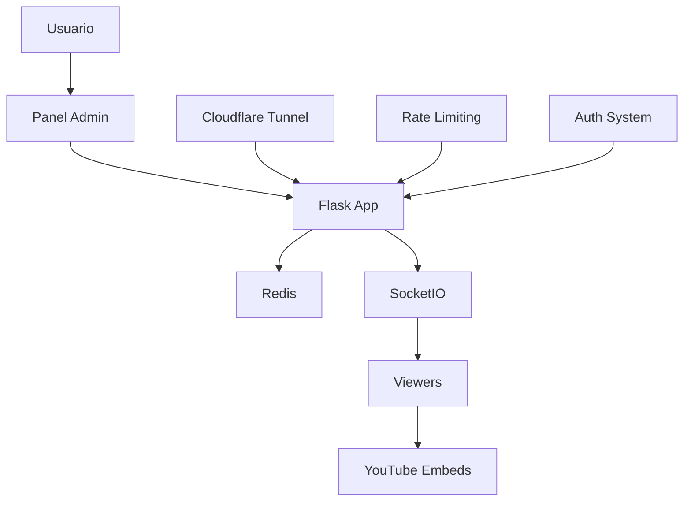

# 🎥 Caos Vision

**Caos Vision** es una aplicación web que permite crear un **muro de videos de YouTube** donde se pueden visualizar múltiples streams simultáneamente en una grilla dinámica. Perfecto para monitoreo de eventos, entretenimiento o vigilancia de contenido.


## 🌟 Características Principales

### 🎬 **Gestión de Streams**
- ✅ Soporte para videos, lives, shorts y embeds de YouTube
- ✅ Extracción automática de ID de video desde diferentes formatos URL
- ✅ Grilla responsive que se ajusta automáticamente
- ✅ Control individual de sonido (mute/unmute)

### 🔐 **Seguridad Robusta**
- ✅ Panel de administración protegido con autenticación
- ✅ Rate limiting para prevenir ataques de fuerza bruta
- ✅ Sesiones persistentes con Redis
- ✅ Headers de seguridad (CSP, HSTS, etc.)
- ✅ Contenedor Docker en modo solo-lectura

### ⚡ **Tiempo Real**
- ✅ Actualizaciones instantáneas vía WebSockets
- ✅ Reconexión automática con fallback a polling
- ✅ Sincronización entre múltiples clientes

### 🌐 **Cloudflare Tunnel Ready**
- ✅ Configuración automática para tunnels
- ✅ Detección de headers Cloudflare
- ✅ CORS dinámico para URLs arbitrarias
- ✅ WebSocket compatible con proxies

## 🚀 Instalación Rápida

### Prerrequisitos
- Docker y Docker Compose
- Cloudflared (opcional, para tunnels)

### 1. Clonar el Repositorio
```bash
git clone https://github.com/aweher/caos-vision.git
cd caos-vision
```

### 2. Configurar Variables de Entorno
```bash
cp env.example .env
# Editar .env con tus credenciales
```

### 3. Ejecutar con Docker
```bash
# Crear directorio de logs (opcional)
mkdir -p ./logs

# Iniciar aplicación
docker-compose up -d

# Ver logs
docker-compose logs -f caos-vision
```

### 4. Acceder a la Aplicación
- **Viewer público**: http://localhost:64500
- **Panel admin**: http://localhost:64500/admin
- **Credenciales**: Las configuradas en tu archivo `.env`

## ⚙️ Configuración

### Variables de Entorno Principales

```bash
# Autenticación
ADMIN_USER=admin
ADMIN_PASS=tu_password_super_seguro
SESSION_SECRET_KEY=una_clave_secreta_muy_larga_y_compleja

# Redis
REDIS_URL=redis://valkey:6379/0

# Cloudflare Tunnel (opcional)
CLOUDFLARE_TUNNEL=true
ALLOWED_ORIGINS=  # Vacío para URLs dinámicas
```

Ver `env.example` para todas las opciones disponibles.

## 🌊 Uso con Cloudflare Tunnel

### Tunnel Temporal (Desarrollo)
```bash
# Iniciar aplicación
docker-compose up -d

# Crear tunnel
cloudflared tunnel --url http://localhost:64500
```

### Tunnel Permanente (Producción)
```bash
# Crear tunnel
cloudflared tunnel create caos-vision-prod
cloudflared tunnel route dns caos-vision-prod caos.tu-dominio.com

# Ejecutar tunnel
cloudflared tunnel run caos-vision-prod
```

📚 **Documentación completa**: Ver [CLOUDFLARE_SETUP.md](CLOUDFLARE_SETUP.md)

## 📖 Guía de Uso

### Como Administrador

1. **Acceder al Panel**
   - Ir a `/admin`
   - Login con credenciales configuradas

2. **Agregar Streams**
   - Pegar URL de YouTube en el campo
   - Hacer clic en "Agregar Stream"
   - Formatos soportados:
     - `https://youtube.com/watch?v=VIDEO_ID`
     - `https://youtu.be/VIDEO_ID`
     - `https://youtube.com/embed/VIDEO_ID`
     - `https://youtube.com/shorts/VIDEO_ID`

3. **Gestionar Streams**
   - **Silenciar/Activar**: Control individual de audio
   - **Eliminar**: Remover streams de la grilla
   - **Vista en tiempo real**: Los cambios se reflejan instantáneamente

### Como Viewer

1. **Acceder a la Vista Principal**
   - Ir a la URL principal (`/`)
   - No requiere autenticación

2. **Funcionalidades**
   - **Auto-layout**: La grilla se organiza automáticamente
   - **Pantalla completa**: Doble clic en cualquier video
   - **Auto-actualización**: Nuevos streams aparecen automáticamente

## 🏗️ Arquitectura Técnica

### Stack Tecnológico
- **Backend**: Python 3.11, Flask, SocketIO
- **Frontend**: HTML5, JavaScript vanilla, CSS3
- **Base de datos**: Redis (sesiones y streams)
- **Web Server**: Gunicorn con workers gevent
- **Contenedor**: Docker con usuario no-root

### Estructura del Proyecto
```
caos-vision/
├── app/
│   ├── app.py                 # Aplicación principal
│   ├── entrypoint.sh          # Script de inicio
│   ├── requirements.txt       # Dependencias Python
│   ├── templates/             # Templates HTML
│   │   ├── index.html         # Vista principal
│   │   ├── admin.html         # Panel administración
│   │   └── login.html         # Página de login
│   └── static/
│       └── styles.css         # Estilos CSS
├── docker-compose.yaml        # Configuración Docker
├── Dockerfile                 # Imagen Docker
├── env.example               # Variables de entorno ejemplo
├── CLOUDFLARE_SETUP.md       # Documentación Cloudflare
└── README.md                 # Este archivo
```

### Flujo de Datos


## 🧪 Testing

### Script de Pruebas Automáticas
```bash
# Ejecutar tests
python test_session.py

# Con URL personalizada
python test_session.py --url https://tu-tunnel.trycloudflare.com
```

### Tests Manuales
1. **Autenticación**: Login/logout, rate limiting
2. **CRUD Streams**: Agregar, eliminar, modificar
3. **WebSockets**: Actualizaciones en tiempo real
4. **Responsive**: Diferentes tamaños de pantalla

## 🔧 Desarrollo

### Entorno Local
```bash
# Clonar repositorio
git clone https://github.com/aweher/caos-vision.git
cd caos-vision

# Crear entorno virtual
python -m venv venv
source venv/bin/activate  # Linux/Mac
# venv\Scripts\activate   # Windows

# Instalar dependencias
pip install -r app/requirements.txt

# Variables de entorno para desarrollo
cp env.example .env
# Editar .env para desarrollo local

# Ejecutar Redis (requerido)
docker run -d -p 6379:6379 redis:alpine

# Ejecutar aplicación
cd app
python app.py
```

### Contribuir
1. Fork del proyecto
2. Crear rama feature (`git checkout -b feature/AmazingFeature`)
3. Commit cambios (`git commit -m 'Add AmazingFeature'`)
4. Push a la rama (`git push origin feature/AmazingFeature`)
5. Abrir Pull Request

## 📊 Casos de Uso

### 🎮 **Gaming & Streaming**
- Monitorear múltiples streamers favoritos
- Eventos de esports con diferentes ángulos
- Compilaciones de highlights en vivo

### 📺 **Entretenimiento**
- Walls de videos musicales
- Canales de noticias simultáneos
- Series web y podcasts

### 🏢 **Empresarial**
- Monitoreo de menciones de marca
- Eventos corporativos multi-cámara
- Training sessions y webinars

### 🔍 **Investigación**
- Análisis de tendencias de contenido
- Monitoreo de competencia
- Investigación de mercado

## 🚨 Solución de Problemas

### Problemas Comunes

**🔥 WebSockets no funcionan**
```bash
# Verificar logs
docker-compose logs -f caos-vision

# Verificar conectividad
curl -I http://localhost:64500
```

**🍪 Sesión no persiste**
```bash
# Verificar variables de entorno
docker-compose exec caos-vision env | grep SESSION

# Verificar Redis
docker-compose exec valkey redis-cli ping
```

**📹 Videos no cargan**
- Verificar que la URL de YouTube sea válida
- Algunos videos tienen restricciones de embed
- Dominios de Cloudflare pueden estar bloqueados por YouTube

### Logs Útiles
```bash
# Logs de aplicación
docker-compose logs -f caos-vision

# Logs de Redis
docker-compose logs -f valkey

# Logs en archivo (si está configurado)
tail -f ./logs/app.log
```

## 🛣️ Roadmap

### v2.0 (Próximo)
- [ ] Layouts personalizables
- [ ] Múltiples salas/canales
- [ ] API REST completa

### v3.0 (Futuro)
- [ ] Chat integrado
- [ ] Notificaciones push
- [ ] Mobile app

## 📄 Licencia

Este proyecto está bajo la Licencia MIT. Ver el archivo [LICENSE](LICENSE) para más detalles.

## 📞 Soporte

- 🐛 **Issues**: [GitHub Issues](https://github.com/aweher/caos-vision/issues)
- 📧 **Email**: ariel@weher.net

---

**⭐ Si te gusta el proyecto, no olvides darle una estrella en GitHub!**

*Desarrollado con ❤️ para la comunidad* 